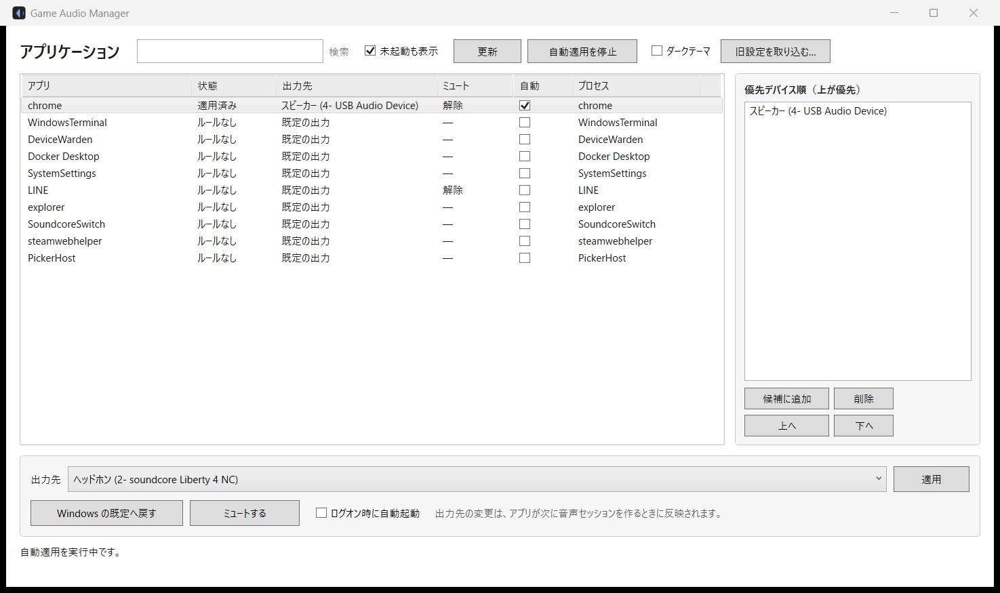
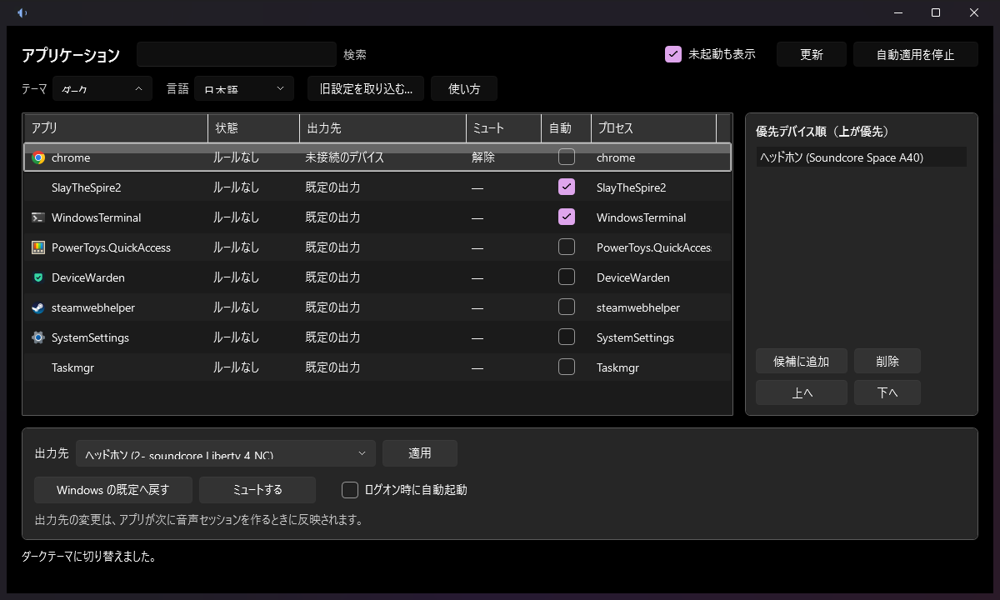

# game-audio-manager

Windows 上でアプリ・ゲームごとの音声出力先とミュートを切り替える常駐アプリです。

- 起動中のアプリを一覧に出し、行ごとに出力先を変更・ミュート・自動適用の ON/OFF ができます
- 登録したアプリはトレイ常駐のまま出力先を自動で維持します（ウィンドウを閉じても継続）
- アプリ別の出力先設定は **追加のツールなし** で行います（Windows の音声ポリシー API を使用）



ダークテーマにも切り替えられます。



## 入手する（デスクトップアプリ版・推奨）

1. [Releases](https://github.com/tonbiattack/game-audio-manager/releases) から最新の `game-audio-manager-<version>-win-x64.zip` をダウンロードします
2. 任意のフォルダへ展開します（例: `C:\apps\GameAudioManager`）
3. `GameAudioManager.exe` を実行します

.NET ランタイムのインストールは不要です（自己完結ビルド）。

- **署名について**: コード署名を行っていないため、初回起動時に SmartScreen の警告が出ることがあります。
  「詳細情報」→「実行」で起動できます
- **設定の保存先**: `%LOCALAPPDATA%\GameAudioManager\settings.json`
- **アンインストール**: 実行ファイルを削除し、`%LOCALAPPDATA%\GameAudioManager` を削除します。
  「ログオン時に自動起動」を有効にしていた場合は、先にアプリ上でオフにしてください

### 使い方

| 操作 | 説明 |
| --- | --- |
| 一覧 | 起動中のアプリを表示。ウィンドウを持たないプロセスは対象外です |
| 検索 | アプリ名・プロセス名で絞り込みます |
| 出力先 | 接続中のデバイスから選び「適用」します |
| ミュート | 1クリックで切り替え。混在状態は `混在 (n)` と表示します |
| 自動 | ON のアプリは出力先を自動で維持します |
| 優先デバイス順 | 右側の一覧で候補と順序を編集できます。上ほど優先されます |
| 自動適用を停止 / 開始 | 常駐処理を一時停止・再開します |
| ログオン時に自動起動 | チェックすると `HKCU\...\Run` に登録します（管理者権限不要） |
| ダークテーマ | ライト/ダークを切り替えます。設定は次回起動時にも保持されます |
| 旧設定を取り込む… | 旧 PowerShell 版の `games.json` を取り込みます（下記「移行」参照） |

### キーボードショートカット

| キー | 動作 |
| --- | --- |
| `Ctrl` + `F` | 検索欄へ移動 |
| `Esc` | 検索をクリア（検索欄にフォーカスがあるとき） |
| `F5` | 一覧を更新 |
| `Ctrl` + `M` | 選択中のアプリのミュート切替 |
| `Ctrl` + `,` | 自動適用の開始 / 停止 |

デバイスの抜き差しとスリープ復帰を検知すると、自動適用を即座に再実行します（定期ポーリングを待ちません）。

ウィンドウを閉じても常駐は続きます。終了するにはタスクトレイのアイコンから「終了」を選びます。

### 出力先の変更が反映されるタイミング

Windows の仕様により、**出力先の変更は「次にそのアプリが音声セッションを作るとき」に反映されます**。
再生中の音は自動では移動しません。アプリを再起動するか、ゲーム内で音声を出し直すと切り替わります。
「既定の出力へ戻す」も同じです。

## ローカルにインストールする（Windows 検索から起動）

GitHub Releases を使わずに、手元のビルドをそのまま導入できます。**管理者権限は不要**です。

```powershell
# ビルド → 配置 → スタートメニュー登録 をまとめて行う
./scripts/install-local.ps1
```

- 配置先: `%LOCALAPPDATA%\Programs\GameAudioManager\`
- ショートカット: `%APPDATA%\Microsoft\Windows\Start Menu\Programs\Game Audio Manager.lnk`
- Windows キーを押して「Game Audio Manager」と入力すると起動できます
- **検索インデックスの反映には数分かかることがあります**。すぐ出ない場合はスタートメニューの
  「すべてのアプリ」から起動してください
- 再実行してもショートカットは重複しません。実行中のアプリは停止してから置き換えます

ビルドをやり直さずに配置だけ更新する場合:

```powershell
./scripts/publish.ps1 -Version 0.2.0
./scripts/install-local.ps1 -SkipPublish
```

### 更新

新しいビルドを取得したら、同じコマンドをもう一度実行します。設定は保持されます。

```powershell
./scripts/install-local.ps1
```

### アンインストール

```powershell
# ショートカットと配置物を削除（設定は保持）
./scripts/install-local.ps1 -Uninstall

# 設定も削除する場合
./scripts/install-local.ps1 -Uninstall -PurgeSettings
```

- 削除するのは**このアプリのショートカットと配置物だけ**です
- 設定（`%LOCALAPPDATA%\GameAudioManager`）は `-PurgeSettings` を指定しない限り残します
- 「ログオン時に自動起動」を有効にしていた場合は、**先にアプリ上でオフにしてから**アンインストールしてください

## 開発

```powershell
dotnet build GameAudioManager.slnx -c Release
dotnet test tests/GameAudioManager.Core.Tests/GameAudioManager.Core.Tests.csproj --no-build -c Release
./scripts/publish.ps1 -Version 0.2.0        # 自己完結 EXE を artifacts/win-x64 に生成
```

技術検証の記録:

- [docs/dotnet-migration.md](docs/dotnet-migration.md) — 移行の経緯、MSIX/EXE/MSI の比較、決定事項
- [docs/audio-policy-api.md](docs/audio-policy-api.md) — 非公開音声 API の検証マトリクスと既知の制限

## PowerShell 版から移行する

旧 PowerShell 版とデスクトップアプリ版は**設定ファイルが別**です。混在させないでください。

### 手順

1. **旧版の常駐を止める**（必須）

   両方を同時に動かすと、同じアプリの出力先を奪い合います。

   ```powershell
   # 旧版の監視プロセスを停止する
   Get-Process powershell | Where-Object {
     $_.CommandLine -like '*watch-game-output.ps1*' -or $_.CommandLine -like '*watch-shiren-output.ps1*'
   } | Stop-Process

   # スタートアップ登録を解除する（登録していた場合）
   .\Install-GameAudioManagerStartup.ps1 -Remove
   ```

2. **デスクトップアプリ版を起動**し、一覧から対象アプリを選び直します。

   旧設定を取り込む場合は、画面上部の「旧設定を取り込む…」で旧 `config/games.json` を選びます。
   デバイス名は接続中のデバイスの ID に解決され、未接続のデバイスは名前のまま保持されます。
   同じアプリのルールは統合され、重複しません。

   - 出力先: ドロップダウンから選んで「適用」
   - 優先順位: 右側の「優先デバイス順」で候補を追加・並べ替え
   - 自動適用: 行の「自動」にチェック
   - ログオン時自動起動: 必要ならチェック

3. 旧版が不要になったら、`config/games.json` などを含む旧フォルダを削除します。

### 設定の対応

| 旧 `config/games.json` | 新 `settings.json` |
| --- | --- |
| `processName` | `rules[].processName` |
| `name` | `rules[].name` |
| `outputDevices`（デバイス**名**） | `rules[].outputDeviceIds`（デバイス **ID**） |
| `enabled` | `rules[].enabled` |
| — | `rules[].autoApply`（新規） |

デバイス名は変更・重複しうるため、新版は ID で保存します。
旧設定の `LegacyImporter` による自動取り込みは Core に実装済みですが、UI からは未提供です
（現状は画面から選び直すのが確実です）。

---

# PowerShell 版（レガシー）

以前の PowerShell + WinForms 実装です。引き続き利用できますが、新機能はデスクトップアプリ版にのみ追加されます。

Windows 上でアプリ・ゲームごとの音声出力先とミュートを切り替える PowerShell ツールです。
GUI から選ぶ方法と、コマンドで指定する方法の両方を用意しています。

- 設定済みのゲームに加えて、**現在ウィンドウを持つ実行中のアプリ**を自動検出して一覧に出します
- アプリごとに「出力先を切り替える」「Windows の既定へ戻す」「ミュートを切り替える」ができます
- 登録したアプリは常駐監視プロセスが自動で出力先を維持します（GUI を閉じても継続）

## 入手する

### Release の ZIP を使う（通常の利用）

1. [Releases](https://github.com/tonbiattack/game-audio-manager/releases) から PowerShell 版の ZIP をダウンロードします
2. 任意のフォルダへ展開します（例: `C:\apps\game-audio-manager`）
3. 展開したフォルダで PowerShell を開き、次を実行します

```powershell
Copy-Item .\config\games.example.json .\config\games.json
.\game-audio-manager.ps1
```

ZIP にはスクリプト一式、`vendor/svcl/` の同梱物一式、`LICENSE`、`THIRD_PARTY_NOTICES.md` が入っています。

### git clone を使う（開発者向け）

```powershell
git clone https://github.com/tonbiattack/game-audio-manager.git
cd game-audio-manager
Copy-Item .\config\games.example.json .\config\games.json
.\game-audio-manager.ps1
```

## 動作環境

- Windows 10 / 11
- Windows PowerShell 5.1 または PowerShell 7 系
- 音声出力の制御に NirSoft SoundVolumeCommandLine を使用（`vendor/svcl/` に同梱）

## GUI を使う

`game-audio-manager.ps1` を起動すると、設定済みのゲームと、現在ウィンドウを持つ実行中のアプリが一覧に出ます。
アプリを選び、接続中の出力先を選んで適用します。設定ファイルが存在しなくても GUI は起動できます。

```powershell
.\game-audio-manager.ps1
```

アプリケーションのプルダウンには、取得可能な場合は実行ファイル（`.exe`）由来のアイコンを 16×16 ピクセルで名前の左に表示します。
権限不足などでアイコンを取得できない場合はアプリ名だけ表示し、選択・音声出力の操作は継続できます。

`優先デバイスを適用` は、各ゲームの `outputDevices` に書かれた順で、現在接続中の最初のデバイスを選びます。
`選択したデバイスを適用` では、接続中の任意の出力先を指定できます。ゲームが起動していない場合は適用できません。

**制限:** ウィンドウがないアプリ、他のプロセスから音を出すアプリ、ブラウザの個別タブは自動検出・個別制御の対象外となる場合があります。
出力先の切替は音声セッションやアプリの仕様に依存するため、実機で音声を確認してください。

### ログオン時に GUI を開く

現在のユーザーのスタートアップへショートカットを登録します。管理者権限は不要です。

```powershell
.\Install-GameAudioManagerStartup.ps1
```

登録を解除する場合は次を実行します。このコマンドは Game Audio Manager のショートカットだけを削除します。

```powershell
.\Install-GameAudioManagerStartup.ps1 -Remove
```

## ゲームを追加・変更する

`config/games.json` の `games` 配列へ次の形式で項目を追加します。
`outputDevices` は左側ほど優先され、`enabled: false` のゲームは GUI に表示されません。

```json
{
  "name": "ゲーム名",
  "processName": "GameExecutableName",
  "outputDevices": [
    "第1候補のデバイス名",
    "第2候補のデバイス名"
  ],
  "enabled": true
}
```

`config/games.json` は端末ごとのデバイス名を含むため Git には追加されません。
初回だけ `config/games.example.json` をコピーして使ってください。

プロセス名はゲームを起動して `detect-game-process.ps1 -ProcessName "候補名"` で確認します。
デバイス名は `set-game-output.ps1 -List` の `指定値` をそのまま使ってください。

## 登録したアプリを常駐監視する

`config/games.json` に登録したゲームを、GUI を閉じていても自動で出力先に切り替える常駐監視プロセスです。
GUI は監視を開始・停止し、ルールを編集し、状態を表示します。
監視は GUI とは別の単一プロセス (`watch-game-output.ps1`) で動作するため、GUI を閉じても適用は継続します。

GUI の右側で監視を操作します。

- `監視ルールに登録`: 右側の「優先デバイス順」の内容を `games.json` に保存します。`games.json` が無い場合は作成します。
- `監視から除外`: 選択中のアプリのルールを `games.json` から削除します。
- `監視を開始` / `監視を停止`: 常駐監視プロセスを制御します。二重起動は自動で防がれます。
- `GUI 起動時に監視を自動開始` と `監視間隔(秒)`: 変更すると `config/settings.json` に保存されます。間隔の変更は監視を再開始した後に反映されます。
- 状態表示: 適用済みデバイス、未起動、優先デバイス未接続、最終エラーを数秒ごとに更新します。

### 優先デバイス順を編集する

GUI の右側に、選択中アプリの**優先デバイス順**が表示されます。上にあるほど優先されます。

| ボタン | 動作 |
| --- | --- |
| `候補に追加` | `出力先` で選んだデバイスを一覧の末尾に追加します。重複は追加しません |
| `候補から削除` | 一覧で選択中のデバイスを候補から削除します |
| `上へ` / `下へ` | 一覧で選択中のデバイスの優先度を1つ上げる／下げる |

編集した順序は `監視ルールに登録` で保存されます。保存後は常駐監視がその順で選びます。

- 未接続のデバイスも候補として残せます（`(未接続)` と表示されます）。ヘッドセットを外してもルールが消えないようにするためです
- 一覧が空のまま `監視ルールに登録` を押すと、`出力先` で選択中のデバイスが1件目として登録されます（従来の使い方）
- 順序の変更は監視の再起動なしに次のサイクルから反映されます

`config/games.json` を直接編集しても同じ結果になります。GUI はその編集を画面から行えるようにしたものです。

コマンドでも管理できます。

```powershell
# 既定設定 (config/games.json, 5秒間隔) で監視する。Ctrl+C で停止。
.\watch-game-output.ps1

# すでに監視が動作中の場合は二重起動せず、そのまま終了します。
.\watch-game-output.ps1 -IntervalSeconds 10
```

監視プロセスは `config/games.json` を各サイクルで読み直すため、GUI でのルール変更を監視の再起動なしに反映します。
`enabled: false` のゲームと未起動のゲームは待機し、起動・デバイス再接続・既定デバイス切替の際に
`outputDevices` の左から見て最初に接続中のデバイスを適用します。適用に失敗した場合は次のサイクルで再試行します。

ログオン時に監視も自動開始するには、スタートアップへ GUI と監視のショートカットをまとめて登録します。

```powershell
.\Install-GameAudioManagerStartup.ps1 -IncludeWatcher
```

## 任意のアプリをコマンドで操作する

アプリの実行ファイル名（`.exe` は付けても省いても構いません）を `-ProcessName` に指定します。

```powershell
# プロセスを検出する
.\detect-game-process.ps1 -ProcessName "ExampleGame"

# 対象アプリの音声セッションをミュート／解除する
.\toggle-game-mute.ps1 -ProcessName "ExampleGame"

# 使用できる出力先を確認する（アプリが未起動でも実行可能）
.\set-game-output.ps1 -List

# 出力先を指定する
.\set-game-output.ps1 -ProcessName "ExampleGame" -Device "Realtek(R) Audio"

# Windows の既定出力へ戻す
.\set-game-output.ps1 -ProcessName "ExampleGame" -Reset
```

プロセスが見つからない場合、エラーには指定したプロセス名が表示されます。
`detect-game-process.ps1` で実行中のプロセス名を確認してください。

### ミュートの対象範囲

`toggle-game-mute.ps1` は、指定したプロセス名に一致する**すべての音声セッション**を対象にします。

- **すべての再生エンドポイント**を走査します。既定以外のデバイスへ出力しているアプリも対象です
- 同じプロセス名の**複数 PID** を扱います。ゲームが子プロセスから音を出している場合も取りこぼしません
- 同じアプリが複数デバイスへ同時に音声セッションを持つ場合、**すべてを同じ状態へ揃えます**

混在状態（一部だけミュート）のときの規則は「**1つでもミュートされていないセッションがあれば、
すべてをミュートする**」です。これにより、トグル後の状態は常に「全ミュート」か「全解除」の
どちらかになります。

現在の状態を確認するには `-Status` を使います。

```powershell
.\toggle-game-mute.ps1 -ProcessName "ExampleGame" -Status
```

```text
ProcessId Device                                Muted
--------- ------                                -----
    31668 スピーカー (Steam Streaming Speakers)  True
    31668 ヘッドホン (soundcore Liberty 4 NC)    True
```

音声セッションがまだ存在しない場合（起動直後で音を出していない等）は、
「No audio session was found」で失敗します。音声を再生させてから再実行してください。

### 出力先変更の対象範囲

`set-game-output.ps1` は `svcl.exe` のアプリ別設定を使うため、**実行ファイル名単位**で適用されます。
同じ名前の PID が複数あってもすべてに効きます。実行時に PID が複数見つかった場合はその旨を表示します。

```text
Detected game process:
  Process: chrome.exe
  PID:     6560, 6760, 7520, 8308, 8368, ... (39 total)
  Note:    39 processes share this name; the output device applies to all of them.
```

### ゲーム別のプロセス名の例

| ゲーム | `-ProcessName` | 実機確認 |
| --- | --- | --- |
| Slay the Spire 2（Steam版） | `SlayTheSpire2` | 未確認 |
| Balatro（Steam版） | `Balatro` | 確認済み |
| RimWorld（Steam版） | `RimWorldWin64` | 確認済み |
| 風来のシレン6（Steam版） | `ShirenTheWanderer6` | 確認済み |

```powershell
.\detect-game-process.ps1 -ProcessName "SlayTheSpire2"
.\toggle-game-mute.ps1 -ProcessName "SlayTheSpire2"
.\set-game-output.ps1 -ProcessName "SlayTheSpire2" -Device "使用するデバイス名"
.\set-game-output.ps1 -ProcessName "SlayTheSpire2" -Reset
```

出力先を選ぶ前に `set-game-output.ps1 -List` を実行し、表示された `指定値` を `-Device` に指定してください。

### RimWorld（Steam版）

Steam版 RimWorld の実行ファイルは `RimWorldWin64.exe`、プロセス名は `RimWorldWin64` です。
Steam のインストール先は既定で `C:\Program Files (x86)\Steam\steamapps\common\RimWorld` です。

```powershell
.\detect-game-process.ps1 -ProcessName "RimWorldWin64"
.\toggle-game-mute.ps1 -ProcessName "RimWorldWin64"
.\set-game-output.ps1 -ProcessName "RimWorldWin64" -Device "使用するデバイス名"
.\set-game-output.ps1 -ProcessName "RimWorldWin64" -Reset
```

実機（Windows 11 / RimWorld Steam版）で次を確認しました。

| 項目 | 結果 |
| --- | --- |
| プロセス検出 | `RimWorldWin64` / PID / ウィンドウタイトル `RimWorld by Ludeon Studios` を検出 |
| ミュート→解除 | 2回の実行で交互に切り替わり、`svcl.exe` の `Muted` 列でも確認 |
| 出力先変更 | 設定は記録され、**次に音声セッションが作られたとき**（ゲーム再起動後）に反映 |
| 既定出力へ戻す | `-Reset` 後に再起動すると Windows の既定デバイスへ戻ることを確認 |

**音声セッションが未生成のときの扱い:** RimWorld は起動直後、音声をまだ再生していないと
音声セッションを持ちません。この状態で `-Device` を実行しても、`svcl.exe` は終了コード 0 を返し
設定は記録されますが、**既存のセッションは移動しません**。設定は次回セッション生成時に効きます。
そのため「実行直後に `-List` で確認しても変わらない」ことがありますが、異常ではありません。
すぐ反映したい場合はゲーム内で音声を再生させるか、ゲームを再起動してください。

ミュートは音声セッションが存在しないと対象がないため、`toggle-game-mute.ps1` は
「No audio session was found」で失敗します。これは仕様です。

## シレン6 専用の手順

旧リポジトリ名（`toggle-shiren-mute`）時代のシレン6専用コマンドは互換ラッパーとして残しています。
手順は [docs/shiren6.md](docs/shiren6.md) に分離しました。

シレン6 は `config/games.json` に登録して汎用 GUI・常駐監視で扱うことを推奨します。

## 手動確認手順

実機のオーディオセッションと出力先は自動テストでは検証できないため、変更後は次を確認してください。

1. 対象ゲームを起動し、`detect-game-process.ps1 -ProcessName "実際のプロセス名"` で PID を確認する。
2. `toggle-game-mute.ps1 -ProcessName "実際のプロセス名" -Status` で対象セッションと現在の状態を確認する。
3. `toggle-game-mute.ps1 -ProcessName "実際のプロセス名"` を2回実行し、ミュートと解除が交互に切り替わることを確認する。
4. `set-game-output.ps1 -List` で有効なデバイス名を確認し、`-Device` で出力先を変更する。
5. `set-game-output.ps1 -ProcessName "実際のプロセス名" -Reset` で Windows の既定出力に戻す。
6. 存在しない名前を指定し、エラーにそのプロセス名が表示されることを確認する。

複数ゲームの同時監視を確認する場合は、2つのゲームを `config/games.json` に登録して
`watch-game-output.ps1` を起動し、`config/watcher-status.json` の `apps` に
ゲームごとの `appliedDevice` が別々に記録されることを確認します。

## 開発

### テスト

デバイス不要のテストは CI（GitHub Actions, `windows-latest`）で push / pull request ごとに実行されます。
手元でも同じコマンドで実行できます。

```powershell
pwsh -NoProfile -File tests/run-all.tests.ps1
```

実機の音声デバイスが必要な確認は CI の対象外です。上記「手動確認手順」で行ってください。

### リポジトリ構成

```text
game-audio-manager.ps1          GUI エントリポイント
detect-game-process.ps1         プロセス検出
set-game-output.ps1             出力先の変更・一覧・リセット
toggle-game-mute.ps1            ミュート切替
watch-game-output.ps1           常駐監視
Install-GameAudioManagerStartup.ps1  スタートアップ登録
lib/                            共有ロジック
config/                         設定（games.json は各自で用意）
tests/                          自動テスト
vendor/svcl/                    SoundVolumeCommandLine 同梱物（未改変）
legacy/shiren6/                 シレン6専用監視の実装
docs/                           補足ドキュメント
```

ルート直下の `*-shiren-*.ps1` は互換ラッパーです。実装は `legacy/shiren6/` にあります。

## ライセンスと同梱コンポーネント

このリポジトリで作成した PowerShell ソースとドキュメントは [MIT License](LICENSE) です。

音声出力の制御には NirSoft の SoundVolumeCommandLine を利用しています。
`vendor/svcl/` にある `svcl.exe`、`svcl.chm`、`readme.txt` は同ツールの未改変の 64-bit 配布物であり、
MIT License の対象外です。配布条件と著作権表記は [Third-party notices](THIRD_PARTY_NOTICES.md) を参照してください。


